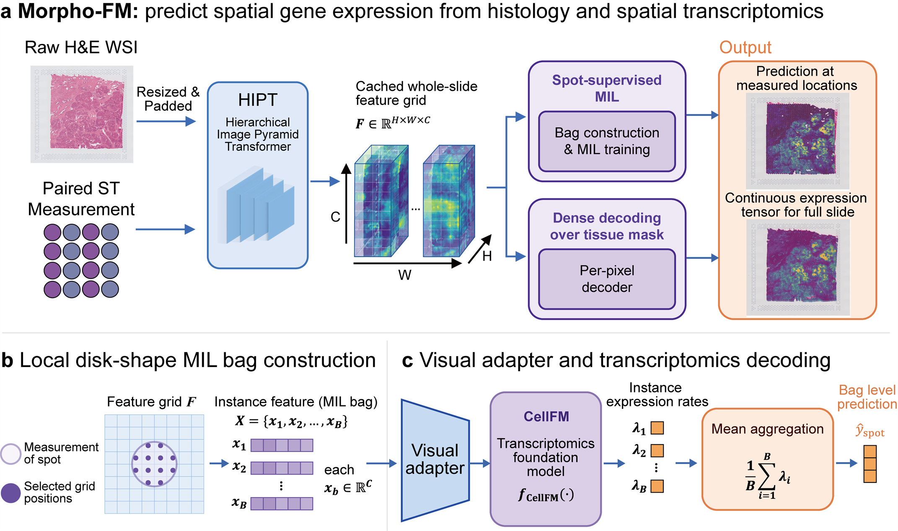

# Morpho-FM

**Morpho-FM couples histology with a pretrained transcriptomic decoder for spatial gene-expression inference**

Jinjin Huang<sup>1</sup>, Xiao Feng<sup>1</sup>, Lianghu Qu<sup>1</sup>, Lingling Zheng<sup>1,*</sup>

<sup>1</sup> MOE Key Laboratory of Gene Function and Regulation, State Key Laboratory for Biocontrol,
Innovation Center for Evolutionary Synthetic Biology, School of Life Sciences / School of Agriculture
and Biotechnology, Sun Yat-sen University Shenzhen Campus, Shenzhen 518107, China.

<sup>*</sup> Correspondence: Lingling Zheng
([zhengll33@mail.sysu.edu.cn](mailto:zhengll33@mail.sysu.edu.cn); Tel. +86-0755-23260262)

Morpho-FM is a weakly supervised framework for predicting relative spatial gene-expression
patterns from routine H&E whole-slide images. A lightweight adapter maps local histological
neighbourhoods into a transcriptomic decoder initialized from CellFM pretraining. The framework
supports prediction at measured spatial transcriptomics locations and candidate dense full-section
relative-expression inference, with dense outputs re-aggregated to the original measurement
support for consistency evaluation.

## Abstract

Paired H&E images and spatial gene-expression measurements remain scarce, limiting
histology-based gene-expression prediction. We developed Morpho-FM, which uses a lightweight
adapter to map local histological neighbourhoods into a transcriptomic decoder space pretrained on
large-scale single-cell data. Morpho-FM ranked first across all held-out prostate and kidney
section-to-section benchmarks and retained its advantage with multi-slide supervision. Matched
initialization controls supported a contribution from transcriptomic pretraining. The model also
transferred to external clear-cell renal cell carcinoma sections and supported
measurement-anchored spatial analyses in breast cancer. Morpho-FM makes pretrained
transcriptomic knowledge reusable for predicting relative spatial gene-expression patterns from
routine histology.

## Reported Results

- In 12 rotating single-slide prostate evaluations, Morpho-FM achieved mean per-gene PCC 0.286,
  compared with 0.155 for the strongest comparator, iStar.
- In four rotating multi-slide prostate folds, Morpho-FM achieved mean per-gene PCC 0.298,
  compared with 0.114 for iStar.
- Across 56 directed kidney section evaluations, Morpho-FM achieved mean per-gene PCC 0.210,
  compared with 0.049 for iStar.
- Matched CellFM initialization controls increased prostate mean PCC by 0.081 under single-slide
  supervision and 0.061 under multi-slide supervision.
- A fixed kidney-trained checkpoint retained mean per-gene PCCs of 0.294 and 0.138 in two
  independently processed external ccRCC sections.

## Workflow



**Fig. 1 overview.** Morpho-FM couples local H&E morphology to transcriptomic
foundation-model decoding in a shared coordinate system.

**a, End-to-end workflow.** Raw H&E whole-slide images and paired spatial transcriptomics
measurements are aligned into a common tissue coordinate system. A cached whole-slide histology
feature grid is constructed offline with a Hierarchical Image Pyramid Transformer (HIPT) encoder.
The same grid supports relative-expression prediction at measured locations and candidate dense
full-section relative-expression inference over the tissue mask. Dense outputs can be re-aggregated
to the original measurement support for consistency evaluation; unmeasured grid positions do not
have direct molecular ground truth.

**b, Local disk-shaped MIL bags.** For each measured ST location, Morpho-FM selects grid
positions within the corresponding spot-radius neighbourhood. These local histology features form
a disk-shaped MIL bag tied to that measured molecular observation.

**c, Visual adapter and transcriptomic decoding.** Instance features from each MIL bag are
projected by a lightweight morphology-to-transcriptome adapter into CellFM, used here as the
single-cell transcriptomic foundation-model decoder. Instance-level relative-expression
predictions are mean-aggregated at the observed location. Location-specific size factors are used
only within the negative-binomial likelihood during model fitting.

## Highlights

- **Transcriptomic foundation priors**: cached histology features are adapted into a pretrained
  single-cell transcriptomic decoder, with CellFM used as the main foundation-model prior.
- **Shared-coordinate inference**: the same HIPT feature grid supports relative-expression
  prediction at measured ST locations and candidate dense full-section inference.
- **Disk-shaped spot-supervised MIL**: each ST measurement supervises a local bag of grid
  positions within the spot-radius neighbourhood.
- **Consistency-aware dense decoding**: candidate dense tissue-wide outputs can be re-aggregated
  to measured locations; this does not directly validate unmeasured grid positions.
- **Count-aware objective**: negative-binomial likelihood is used for overdispersed spatial
  expression counts during spot-level supervision.
- **Benchmark-ready notebooks**: tracked notebooks provide standard Morpho-FM workflows and
  comparisons to representative histology-to-transcriptomics baselines.

## Repository Layout

```text
Morpho-FM/
+-- benchmark/                     # Baseline benchmark notebooks and HEST dataset helper
+-- configs/st_mil.yaml            # Example training/inference configuration
+-- Fig/workflow.png               # Manuscript workflow figure used in this README
+-- LICENSE                        # Apache License 2.0 for original Morpho-FM code
+-- notebooks/                     # Main Morpho-FM and Xenium example notebooks
+-- scripts/convert_cellfm_ckpt.py # MindSpore CellFM checkpoint conversion helper
+-- src/st_pipeline/               # Core data, model, training, inference, and super-resolution code
+-- THIRD_PARTY_NOTICES.md         # Third-party provenance and license boundaries
```

Large datasets, checkpoints, raw results, logs, and local figure-generation outputs are intentionally
kept outside version control.

## Installation

Create an isolated Python environment, then install the project dependencies:

```bash
pip install -r requirements.txt
```

For local development, run commands with the repository root on `PYTHONPATH`:

```bash
export PYTHONPATH=src:$PYTHONPATH
```

On Windows PowerShell:

```powershell
$env:PYTHONPATH = "src;$env:PYTHONPATH"
```

## External Components

External repositories, datasets, vocabularies, and pretrained weights are not vendored as
Morpho-FM Apache-2.0 content. Local source checkouts belong under the ignored
`third_party/` directory. The audited revisions used for the release documentation are:

| Component | Official source | Fixed revision | Purpose |
| --- | --- | --- | --- |
| CellFM | <https://github.com/biomed-AI/CellFM> | `76557975c935d6822ddcfd8bb9700d0b95ec7dd7` | Gene vocabulary and upstream architecture reference |
| HIPT | <https://github.com/mahmoodlab/HIPT> | `780fafaed2e5b112bc1ed6e78852af1fe6714342` | Histology encoder weights and upstream implementation |
| HEST | <https://github.com/mahmoodlab/HEST> | `2c777630b1e8a74db6b36ef05582de3bd52ccb61` | Dataset access and preprocessing |
| LazySlide | <https://github.com/rendeirolab/LazySlide> | `6b9b0e760e83f8220a47b9c03b573fa1519d8aa0` | Optional whole-slide processing |
| sCellST | <https://github.com/loicchadoutaud/sCellST> | `96c3aa2af19e928920b351343272846d1f74fac0` | Benchmark implementation |
| ST-Net | <https://github.com/bryanhe/ST-Net> | `43022c1cb7de1540d5a74ea2338a12c82491c5ad` | Benchmark implementation |

For example, obtain the CellFM vocabulary without adding CellFM source to this repository:

```bash
git clone https://github.com/biomed-AI/CellFM.git third_party/CellFM
git -C third_party/CellFM checkout 76557975c935d6822ddcfd8bb9700d0b95ec7dd7
```

The licenses and distribution status of these components are recorded in
[`THIRD_PARTY_NOTICES.md`](THIRD_PARTY_NOTICES.md).

## Data and Model Preparation

Morpho-FM expects preprocessed spatial transcriptomics data and cell-level morphology embeddings.
The example configuration in `configs/st_mil.yaml` contains the key paths:

- `data.h5ad_path`: AnnData file containing measured spatial expression.
- `data.cell_emb_h5`: HDF5 file containing cell morphology embeddings and cell barcodes.
- `data.gene_vocab_path`: CellFM vocabulary obtained from the official CellFM source, such as
  `third_party/CellFM/csv/expand_gene_info.csv`.
- `model.cellfm_checkpoint`: local CellFM checkpoint converted to PyTorch format.

CellFM pretrained weights are not distributed with Morpho-FM. Obtain them from the official
[CellFM Hugging Face model page](https://huggingface.co/ShangguanNingyuan/CellFM) and comply
with its model-card license. Do not add the original checkpoint, a converted full checkpoint, or a
fine-tuned checkpoint containing CellFM parameters to GitHub or Zenodo.

Convert a user-supplied MindSpore checkpoint locally before training:

```bash
python scripts/convert_cellfm_ckpt.py \
  --ckpt /path/to/CellFM_80M_weight.ckpt \
  --out /path/to/CellFM_80M_weight.pt
```

For the CellFM 80M checkpoint, use
`third_party/CellFM/csv/expand_gene_info.csv` as the gene vocabulary. The conversion script
does not download or redistribute CellFM.

For HIPT feature extraction, obtain `vit256_small_dino.pth` and `vit4k_xs_dino.pth` from the
[official HIPT repository](https://github.com/mahmoodlab/HIPT) and keep them in a local,
ignored model directory. Pass that directory to the feature-cache workflow; HIPT weights are not
distributed with Morpho-FM.

## Quick Start

Edit `configs/st_mil.yaml` so that all data, embedding, vocabulary, checkpoint, and output paths
point to local files. Then run training:

```bash
PYTHONPATH=src python src/st_pipeline/train/train_cli.py \
  --config configs/st_mil.yaml
```

Run spot-level prediction from a trained checkpoint:

```bash
PYTHONPATH=src python src/st_pipeline/infer/predict_cli.py \
  --config configs/st_mil.yaml \
  --checkpoint checkpoints/st_mil/best_model.pt
```

Add `--save_instance` to also save cell-level predictions.

## Notebooks

Tracked example notebooks:

- `notebooks/01_st_mil_hest_multi.ipynb`: multi-slide Morpho-FM training and prediction.
- `notebooks/02_st_mil_hest_single.ipynb`: single-slide Morpho-FM training and prediction.
- `notebooks/101_xenium_preprocess.ipynb`: Xenium preprocessing example.
- `notebooks/102_xenium_generate_cache.ipynb`: Xenium cache generation.
- `notebooks/103_xenium_train.ipynb`: Xenium model training.
- `notebooks/104_xenium_predict.ipynb`: Xenium prediction and visualization.

## Benchmark Suite

The manuscript benchmark compares Morpho-FM with five representative
histology-to-expression methods: HisToGene, iStar, mclSTExp, sCellST, and
HiST. A THItoGene notebook is retained as an additional compatibility workflow
but is not part of the five-method comparison reported in the manuscript.

| Method | Notebook | Reported in manuscript | Scope |
| --- | --- | --- | --- |
| HisToGene | `benchmark/01_HisToGene_benchmark.ipynb` | Yes | Transformer-based spot expression prediction |
| iStar | `benchmark/02_iStar_benchmark.ipynb` | Yes | Image-to-ST prediction and spatial enhancement |
| mclSTExp | `benchmark/03_mclSTExp_benchmark.ipynb` | Yes | Contrastive histology-to-expression prediction |
| sCellST | `benchmark/04_sCellST_benchmark.ipynb` | Yes | Cell-aware expression prediction |
| THItoGene | `benchmark/05_THItoGene_benchmark.ipynb` | No; additional workflow | Histology-to-gene transformer |
| HiST | `benchmark/06_HiST_benchmark.ipynb` | Yes | Histology-based spatial transcriptomics prediction |

Local protocol variants, including kidney-specific, single-slice, INTxx, cached result, and
method-source directories, are useful for experiments but remain local and
untracked. Fixed source revisions and licenses for all benchmark methods are
listed in [`THIRD_PARTY_NOTICES.md`](THIRD_PARTY_NOTICES.md).

## Data Availability

The study uses public datasets obtained directly from their original sources:

- HEST-1k prostate and kidney sections:
  <https://huggingface.co/datasets/MahmoodLab/hest>
- 10x Genomics Xenium breast preview dataset:
  <https://www.10xgenomics.com/products/xenium-in-situ/preview-dataset-human-breast>
- HER2ST patient H sections: <https://doi.org/10.5281/zenodo.4751624>
- External ccRCC Visium sections: GEO
  [GSE210038](https://www.ncbi.nlm.nih.gov/geo/query/acc.cgi?acc=GSE210038)

No study dataset is distributed in this repository.

## Version-Control Hygiene

Before publishing or pushing changes, check the exact files that will be included:

```bash
git status --short
git diff
git diff --cached --name-status
git ls-files '*.ckpt' '*.pt' '*.pth' '*.bin' '*.safetensors'
git ls-files -s third_party
```

Do not add local outputs such as `figures_*`, `results/`, `checkpoints/`, `logs/`, `scratch/`,
temporary notebooks, local third-party source directories, converted model
weights, or private manuscript files.

## Citation

If you use Morpho-FM, please cite the manuscript:

```bibtex
@article{huang2026morphofm,
  title  = {Morpho-FM couples histology with a pretrained transcriptomic decoder for spatial gene-expression inference},
  author = {Huang, Jinjin and Feng, Xiao and Qu, Lianghu and Zheng, Lingling},
  year   = {2026},
  note   = {Manuscript}
}
```

## License

Copyright 2026 Jinjin Huang and Morpho-FM contributors.

Except where otherwise noted, the original Morpho-FM source code is
licensed under the [Apache License 2.0](LICENSE).

Third-party code, data assets, pretrained weights and model checkpoints
are not covered by this license and remain subject to their respective
terms, as documented in [`THIRD_PARTY_NOTICES.md`](THIRD_PARTY_NOTICES.md).

CellFM pretrained weights are not distributed with Morpho-FM and must
be obtained separately from the original CellFM source.

## Contact

For questions about the method or manuscript, please contact Lingling Zheng at
[zhengll33@mail.sysu.edu.cn](mailto:zhengll33@mail.sysu.edu.cn).
